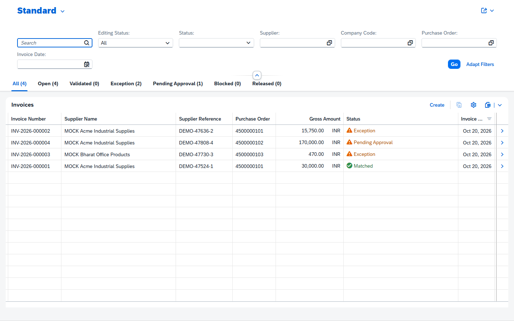
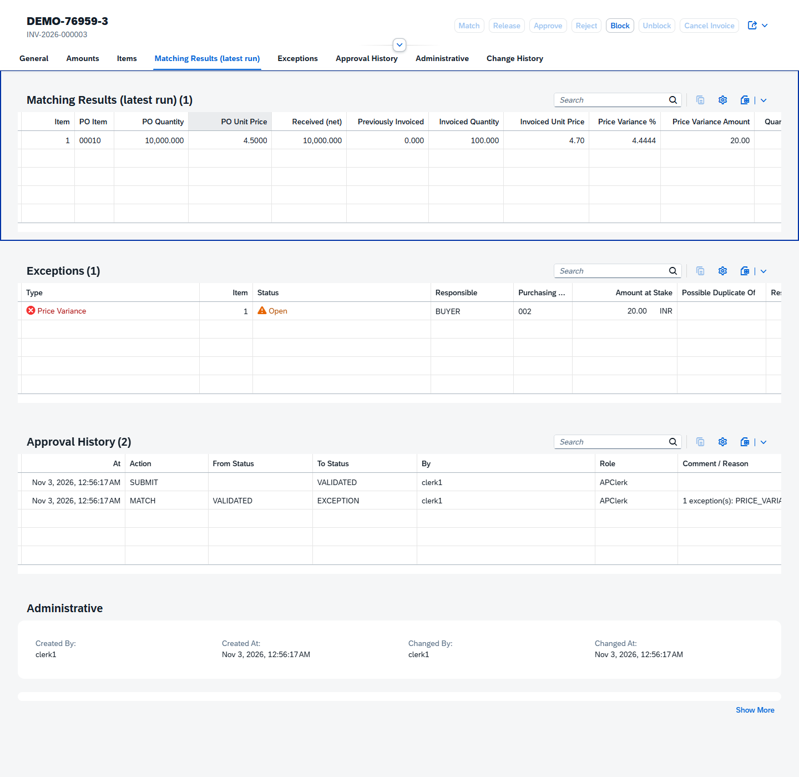
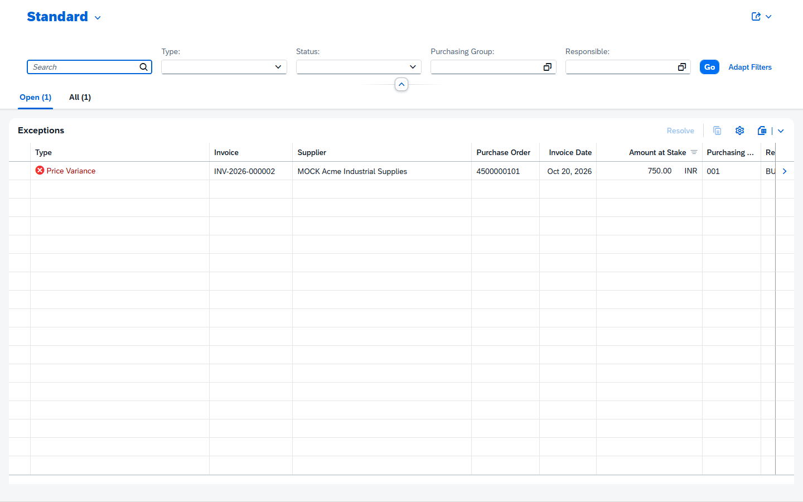
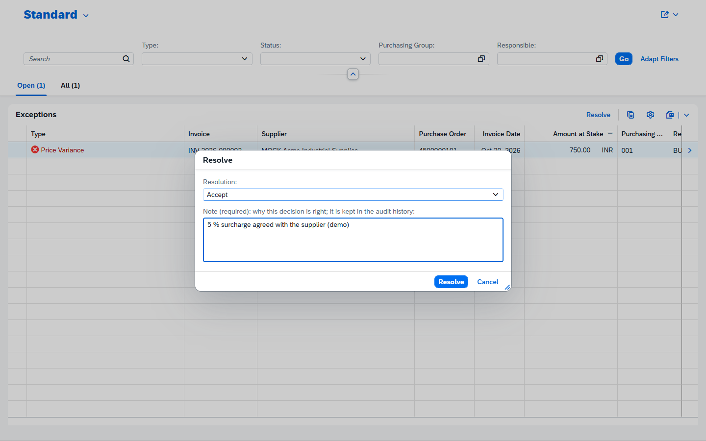
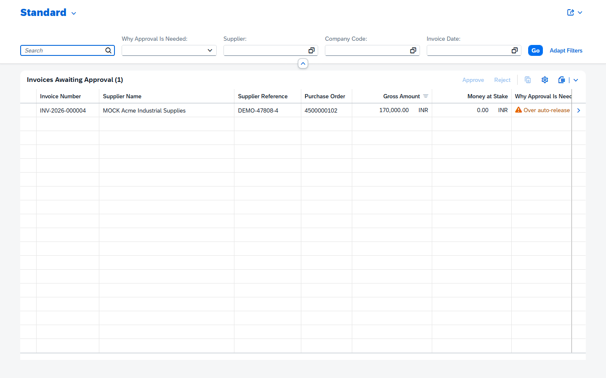
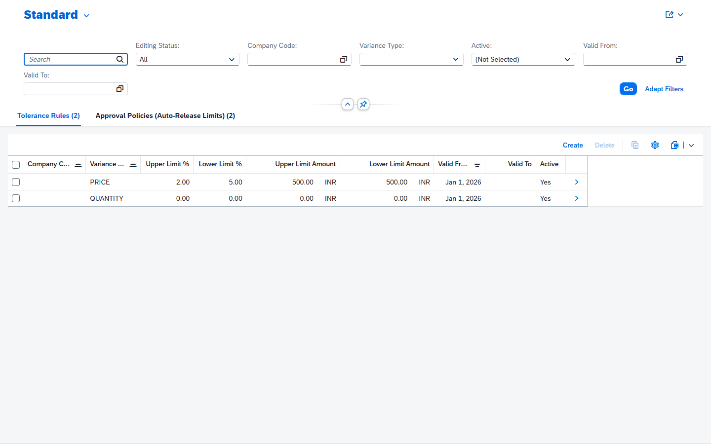
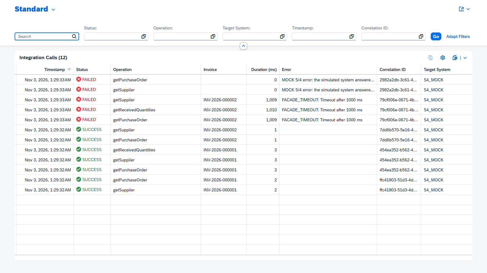
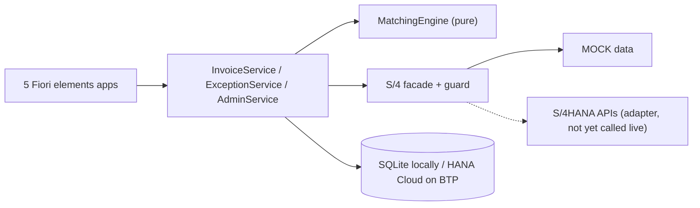

# Invoice 3-Way Match Workbench

[](https://github.com/shreyas0917/Invoice-3-Way-Match-Public/actions/workflows/test.yml)

An SAP CAP (Node.js) and SAP Fiori elements application for accounts payable: it checks supplier
invoices against purchase orders and goods receipts within configurable tolerances, routes every
mismatch to the person responsible for it, and keeps a complete audit trail.

> **Project status (honest summary)**
> - Runs fully on a laptop: SQLite, mocked users, **MOCK** S/4HANA data. **388 automated tests** - all pass with the SAP API files present;
>   without them (the default for this repository) 358 pass and 30 adapter tests are skipped.
> - An adapter for the **official SAP S/4HANA APIs** is implemented and tested against local mocks
>   and a fake SAP server - **no real S/4HANA system has been called**.
> - The project includes SAP BTP deployment configuration (HANA Cloud, XSUAA, App Router,
>   destinations; the MTA archive builds locally), but deployment and live SAP service connectivity
>   have not yet been verified - no real XSUAA login and no HANA persistence have been tested.
> - **SAP API specifications are not included.** The adapter needs SAP's API files, which you obtain
>   with your own SAP account: see [docs/sap-api-setup.md](docs/sap-api-setup.md).

## The business problem

Before an invoice is paid, accounts payable checks three documents agree: the **purchase order**
(what was ordered, at what price), the **goods receipt** (what actually arrived) and the
**invoice** (what the supplier charges). Done by hand this is slow and error-prone: small price
differences, partial deliveries, reversed receipts and duplicate invoices slip through, and nobody
knows who should decide a mismatch. This workbench automates the check and turns every mismatch
into an exception for the right person - the buyer of the purchasing group, or the AP manager.

## Key capabilities

- **Invoice entry with validation** - Fiori draft, submission rules V1-V10 on Save (amounts,
  supplier, PO, currency, units, dates; 16 distinct error codes) and exact-duplicate blocking.
- **Three-way matching** - price, goods receipt and quantity per item with tolerance rules per
  company code; suspected duplicates; auto-release limit per company code.
- **Exception workflow** - buyers resolve price, quantity and missing-receipt exceptions of their
  own purchasing group (accept, rematch, reject); AP managers approve, reject, block and unblock.
- **Status machine and audit** - one transition table, one writer; approval history, field-level
  change history and every match run kept.
- **Exact decimal arithmetic** - money and quantities as BigInt-based exact values (no floating-point
  rounding errors), including PO prices per price unit (e.g. 450 per 100 sheets).
- **Concurrency protection** - ETags against stale updates; parallel "Match" clicks on one invoice
  produce exactly one run (compare-and-set status change, tested with parallel requests).
- **Security** - role-based access (AP Clerk, Buyer, AP Manager), purchasing-group isolation,
  segregation of duties (nobody approves their own invoice).
- **S/4HANA integration layer** - one facade contract, a MOCK implementation and an adapter for
  the official SAP APIs (OData V4 Purchase Order, OData V2 Material Document and Business Partner),
  with 5 s timeouts, safe error messages and an Integration Log of every call.

## Screenshots

Real screenshots from a local run (headless Chrome, MOCK data, mocked users).

| | |
|---|---|
|  Invoice Workbench - status tabs (clerk) |  Matching results: 450 per 100 sheets = unit price 4.50, invoiced 4.70 -> price exception |
|  Exception Worklist - buyer sees only purchasing group 001 |  Resolving an exception with a required note |
|  Approval Queue - over the auto-release limit |  Tolerance rules (+2 % / -5 %, 500 INR) |
|  Integration Log - real SUCCESS and FAILED calls (simulated timeouts and errors) | |

No screenshots or recording exist of a BTP deployment, because there has not been one.

## Architecture

One CAP Node.js application (modular monolith): three OData V4 services for the five Fiori apps
(InvoiceService, ExceptionService, AdminService) and two internal services (MatchingEngine, the S/4
facade ExternalPurchaseOrderService). Business rules are pure functions in `srv/lib/`.



Release notes: [docs/release-notes.md](docs/release-notes.md). More: [architecture overview](docs/architecture-overview.md) (diagrams of model, lifecycle, matching,
integration, deployment), [technical decisions](docs/technical-decisions.md), and 9 architecture
decision records in [`docs/adr/`](docs/adr/).

## Technology stack

| Area | Technology |
|---|---|
| Backend | SAP Cloud Application Programming Model (CAP) Node.js 10, CommonJS, Node.js 24 |
| API | OData V4 (own services); OData V4 and V2 clients for the SAP APIs |
| UI | SAP Fiori elements (List Report, Object Page), SAPUI5 1.148 |
| Database | SQLite (local, tests); SAP HANA Cloud via `@cap-js/hana` (configured for BTP) |
| Audit | `@cap-js/change-tracking` plus own ApprovalHistory and MessageLog |
| Security | CAP `@requires` / `@restrict`; mocked users locally; XSUAA configured for BTP |
| Integration | SAP API definitions from the SAP Business Accelerator Hub, `cds import`, SAP Cloud SDK (destinations) |
| Tests | Jest 30, `@cap-js/cds-test`; GitHub Actions (`.github/workflows/test.yml`, read-only permissions, actions pinned to commit SHAs) runs on every push: 358 passed, 30 skipped (SAP files absent) - see the badge above |
| Deployment (prepared) | MTA (`mta.yaml`), Cloud MTA Build Tool, App Router, Cloud Foundry |

## Running the tests

```sh
npm test                 # 388 tests (24 suites), about a minute, no network or SAP system needed
                         # without the SAP API files: 358 run, 30 adapter tests skipped (docs/sap-api-setup.md)
```

| Suite folder | What it covers |
|---|---|
| `test/unit/` | pure logic: decimals, tolerances, matching, duplicates, validation, status machine, facade guard (5 s boundary with fake timers), adapter mapping, deployment configuration |
| `test/service/` | real OData requests: validation, matching, status and audit, authorization matrix, Fiori app backends, integration hardening (timeouts, rollback, parallel match), XSUAA-shaped attributes |
| `test/integration/` | the facade contract against both implementations; the adapter through real OData V2/V4 clients against a fake SAP server |

## Demo

`docs/demo-script.md` is a 10-minute click-through (clerk -> buyer -> manager) through all five apps.
Every step was run in a browser locally. Its BTP section is still open.

## Try it locally

```sh
npm install
npm run watch            # http://localhost:4004
```

Open http://localhost:4004: the launch page links the five apps - Invoice Workbench, Exception Worklist,
Approval Queue, Tolerance Configuration, Integration Log. Log in as `clerk1` (or another user below)
with an empty password. A 10-minute click-through is in `docs/demo-script.md`.
Mocked users (development/test only): `clerk1`, `clerk2`, `buyer1`, `buyer2`, `manager1`, `nobody`.

## What is real and what is mock

| Part | Status |
|---|---|
| CDS model, OData V4 InvoiceService, draft handling, Fiori elements UI | real CAP / Fiori elements |
| Suppliers, purchase orders, goods receipts (`mock-data/s4mock`) | **mock**, hand-made data |
| `ExternalPurchaseOrderService` facade | real contract; **mock** implementation by default (`srv/external/mock-po-service.js`), S/4 adapter optional (below) |
| SAP API definitions | **not included** - official specifications from the SAP Business Accelerator Hub; obtain them with your own SAP account ([setup](docs/sap-api-setup.md)) |
| S/4 adapter (`srv/external/s4-adapter.js`) | real mapping code, run against **local CAP mocks** of the SAP APIs with **synthetic** data (`mock-data/s4api/fixtures.js`; the CSVs are generated locally) |
| Users and roles | **mocked** authentication locally; XSUAA configured for BTP (not yet verified with a real login) |
| Integration Log (`MessageLog`) | real rows, one per facade call - currently all calls go to the **mock** (`S4_MOCK`) |

### Simulating S/4 failures (mock only)

Every S/4 call has a 5 s timeout; a failure answers 503 `S4_UNAVAILABLE`, changes nothing and is
logged as FAILED in the Integration Log. To see it, start the server with a simulated failure:

```sh
# bash
cds_requires_ExternalPurchaseOrderService_mock_failureMode=error npm run watch     # or: timeout
# PowerShell
$env:cds_requires_ExternalPurchaseOrderService_mock_failureMode='timeout'; npm run watch
```

`none` is the default. Optionally shorten the wait with `cds_requires_ExternalPurchaseOrderService_timeout=1000`.
Only the mock reads this setting; the real adapter never does (see `docs/adr/0007-integration-hardening.md`).

## S/4HANA integration maturity

| Stage | What it means | Status |
|---|---|---|
| 1 - Local mock | Hand-made supplier, PO and goods receipt data behind the facade | **done** (default) |
| 2 - Official SAP API definitions + local adapter | SAP's API contracts imported, adapter mappings implemented, tested against CAP's local mocks of those APIs and a fake SAP HTTP server | **done** (phase 10) |
| 3 - Real endpoint connectivity | SAP BTP destinations, communication arrangement, credentials, tests against a real S/4HANA system | **configured, not verified** (phase 11: destinations wired, no endpoint called) |

Stage 2 is **not** a live SAP integration: no real S/4HANA endpoint has been called.

| Where it runs | What is verified |
|---|---|
| Local, mock (`npm run watch`) | everything: the automated test suite, browser click-through (phases 7/8) |
| Local, SAP-shaped adapter (`npm run watch:s4`) | adapter contract tests, end-to-end match, fake SAP server over HTTP |
| SAP BTP (`mbt build` + `cf deploy`) | **built only**: MTA archive, production build, App Router and production profile started locally with fake bindings. **Not deployed**: no real XSUAA login, HANA persistence or demo run on BTP yet |
| Live S/4HANA | **not verified** - needs a destination to a real system (or the api.sap.com sandbox, which is SAP demo data, not a transactional system) |

### SAP APIs used (SAP S/4HANA, read-only)

| API | Protocol | Version | Used for |
|---|---|---|---|
| `API_PURCHASEORDER_2` (Purchase Order) | OData V4 | 1.3.0 | PO header and items (getPurchaseOrder, searchPurchaseOrders, listPurchaseOrderItems) |
| `API_MATERIAL_DOCUMENT_SRV` (Material Documents) | OData V2 | 1.3.0 | goods receipts 101 / reversals 102 (getReceivedQuantities) |
| `API_BUSINESS_PARTNER` (Business Partner) | OData V2 | 1.6.0 | suppliers (getSupplier, searchSuppliers) |

Source: SAP Business Accelerator Hub, https://api.sap.com. The specifications are **not included** in this
repository; versions, checksums and import commands: [docs/sap-api-setup.md](docs/sap-api-setup.md). Mapping decisions and limitations: `docs/adr/0008-s4-api-adapter.md`.

### Running with the S/4 adapter

Prerequisite: the SAP API files, imported as described in [docs/sap-api-setup.md](docs/sap-api-setup.md).

```sh
npm run watch:s4           # = cds watch --profile s4-adapter: adapter + local CAP mocks of the SAP APIs
```

The log says `SAP APIs: LOCAL CAP MOCKS ... no S/4HANA system is called`, and the Integration Log shows
target system `S4_CAP_MOCK`. The local SAP data is generated from `mock-data/s4api/fixtures.js`
(`npm run s4:fixtures`; `watch:s4` runs it first). Business logic, apps and authorization are identical in both modes.

Pointing the adapter at a real system (phase 11, untested) is configuration only - credentials for
all three services, e.g. via `cds bind`, destinations, or `CDS_CONFIG` (the `cds_requires_<name>_...`
environment variables cannot express service names that contain underscores):

```sh
CDS_ENV=s4-adapter CDS_CONFIG='{"requires":{
  "API_PURCHASEORDER_2":   {"credentials":{"url":"<service root URL of API_PURCHASEORDER_2>"}},
  "API_MATERIAL_DOCUMENT": {"credentials":{"url":"<service root URL of API_MATERIAL_DOCUMENT_SRV>"}},
  "API_BUSINESS_PARTNER":  {"credentials":{"url":"<service root URL of API_BUSINESS_PARTNER>"}}}}' npm start
```

The service root URLs come from the S/4HANA system (communication arrangement). Never commit
credentials. Misconfiguration fails at startup with a clear message - there is no silent fallback to
the mock: missing SAP service configuration, a mix of remote and mocked APIs, or (in production) no
credentials at all. In production the adapter uses the BTP destinations described in
"Deploying to SAP BTP" below.

## Users and authorization (local development only)

Authentication is **mocked** in the `development` and `test` profiles: users are defined in
`package.json`, log in with HTTP basic authentication and an empty password, and never exist
in production (the production profile uses JWT tokens from XSUAA).

| User | Role | Attribute | Can |
|---|---|---|---|
| clerk1, clerk2 | APClerk | - | enter and submit invoices, match, release, block |
| buyer1 | Buyer | purchasingGroup 001 | see and resolve group 001 price, quantity and missing-GR exceptions |
| buyer2 | Buyer | purchasingGroup 002 | the same for group 002 |
| manager1 | APManager | - | match, release, approve (not own invoices), reject, block, unblock, cancel, resolve all exceptions, maintain tolerances and approval policies |
| nobody | - | - | nothing (403 everywhere) |

The rules are declared with `@requires` / `@restrict` in `srv/*-service.cds`; see
`docs/adr/0005-authorization.md`.

On SAP BTP the same roles come from XSUAA - see "Deploying to SAP BTP" below. The CDS
authorization annotations are unchanged.

## Deploying to SAP BTP (Cloud Foundry)

Prepared in phase 11 (`docs/adr/0009-btp-deployment.md`). **It has not been deployed yet** - the
steps below are the remaining manual work. Everything up to `mbt build` is verified locally.

### Architecture

```
Browser -> App Router "invoice-workbench" (XSUAA login, serves the 5 Fiori apps)
             --/odata + JWT--> CAP service "invoice-workbench-srv"
                                 |- SAP HANA Cloud (HDI container, deployed by "invoice-workbench-db-deployer")
                                 |- Destination service -> S/4HANA APIs (S4HANA_* destinations)
```

### What the subaccount needs

| Service / entitlement | Plan | Used by | Cost note |
|---|---|---|---|
| Cloud Foundry Runtime | MEMORY | 3 apps, 256 MB each (768 MB) + staging | free tier / trial quota |
| SAP HANA Cloud | free tier or a paid plan | the database instance (create it once, map it to the CF space) | free tier stops nightly; restart it |
| SAP HANA Schemas & HDI Containers | `hdi-shared` | `invoice-workbench-db` | - |
| Authorization and Trust Management (XSUAA) | `application` | `invoice-workbench-auth` | - |
| Destination service | `lite` | `invoice-workbench-destination` | - |

Plan names and prices differ by account type and region - check them in the subaccount's
entitlements before deploying. Billable resources are created only by `cf deploy` (CF apps,
service instances) and by creating the HANA Cloud instance;
`cf undeploy invoice-workbench --delete-services` removes what `cf deploy` created.

### One-time setup (manual)

1. BTP subaccount with Cloud Foundry enabled; a CF org and space; the entitlements above.
2. SAP HANA Cloud: create an instance, allow your CF space (instance mapping), start it.
3. Tools: Cloud Foundry CLI v8 with the MultiApps plugin (`cf install-plugin multiapps`), `mbt`
   (`npm i -g mbt` or `npx mbt`), GNU make.

### Build and deploy

```sh
npx mbt build -t mta_archives          # = npm ci, cds build --production, UI copy, archive
cf login -a <api-endpoint>             # your region's CF API, then org and space
cf deploy mta_archives/invoice-workbench_0.1.0.mtar
```

The archive contains the CAP service, the HDI deployer (tables, views, `db/data` code lists and
default configuration - no invoices, no test or MOCK data) and the App Router with the five apps.

### Users and role collections

`cf deploy` creates the role collections `AP_Clerk (invoice-workbench <org>-<space>)` and
`AP_Manager (invoice-workbench <org>-<space>)`. Buyers need a purchasing group, so an
administrator creates them in the BTP cockpit (Security):

1. *Roles*: from template **Buyer** of application `invoice-workbench-<org>-<space>`, create role
   `Buyer 001` with attribute **purchasingGroup** = static value `001` (several values allowed),
   or source *Identity Provider* to take it from a user attribute of the IdP.
2. *Role collections*: create `AP_Buyer_001` containing role `Buyer 001` (likewise `AP_Buyer_002`).
3. *Users*: assign role collections to users (or map them to IdP groups).

A Buyer role without a purchasing group sees no exceptions at all (fails closed). Separation of
duties (no approval of one's own invoices) is enforced by the application regardless of role
assignments.

### S/4HANA destinations

Create three destinations (subaccount or the `invoice-workbench-destination` instance); the names
are fixed in `package.json` (`[production]`):

| Destination | API | URL = service root of |
|---|---|---|
| `S4HANA_PURCHASEORDER_2` | Purchase Order, OData V4 | API_PURCHASEORDER_2 |
| `S4HANA_MATERIAL_DOCUMENT` | Material Documents, OData V2 | API_MATERIAL_DOCUMENT_SRV |
| `S4HANA_BUSINESS_PARTNER` | Business Partner, OData V2 | API_BUSINESS_PARTNER |

Type HTTP, proxy type Internet, authentication as agreed with the S/4HANA system (for example a
communication user). For the **api.sap.com sandbox**: no authentication plus the additional
property `URL.headers.APIKey` = your personal API key - that is SAP's read-only demo data, not a
live business system, and its API versions may differ from the definitions this project was built with.
An on-premise system additionally needs the Connectivity service and SAP Cloud Connector.
Without the destinations the app still starts; every S/4 call then fails with 503
S4_UNAVAILABLE and is listed in the Integration Log.

### Configuration and secrets

- No credentials in Git: XSUAA and HANA credentials come from service bindings, S/4 credentials
  from destinations. `.env` and `default-*.json` are git-ignored; `.env.example` lists the local
  settings.
- Production logs are JSON (CAP default). Raw SAP responses are not logged; failed S/4 calls
  appear as sanitized `s4-facade` warnings with the correlation ID.
- Local SQLite (in memory, seeded from CSV) versus production HANA Cloud (HDI container, only
  `db/data` seeded): local data is never copied to HANA.

## Deployment readiness and what is still needed

| Milestone | Status |
|---|---|
| Local application, tests, browser demo | done and verified |
| Adapter for official SAP APIs (local mocks, fake SAP server) | done and verified locally |
| BTP configuration (`mta.yaml`, `xs-security.json`, App Router, HANA, destinations) and `mbt build` | done; archive builds locally |
| Deployment to SAP BTP Cloud Foundry | **not done** - needs a BTP subaccount |
| Real XSUAA login, HANA persistence, demo on BTP, recording | **not verified** |
| Live S/4HANA (or api.sap.com sandbox) connectivity | **not verified** |

To finish: a BTP subaccount with Cloud Foundry, HANA Cloud and the entitlements above; `cf deploy`;
Buyer role collections and test users; the three S4HANA destinations; then the BTP section of
`docs/demo-script.md`. See `docs/adr/0009-btp-deployment.md`.

## License

The original material of this project is licensed under the [MIT License](LICENSE). It does not
cover SAP materials, SAPUI5, dependencies or trademarks - see [NOTICE.md](NOTICE.md). This repository contains **no SAP API specifications** and no models generated
from them; anyone using the adapter obtains them from SAP under the terms that apply to them
([docs/sap-api-setup.md](docs/sap-api-setup.md)).
