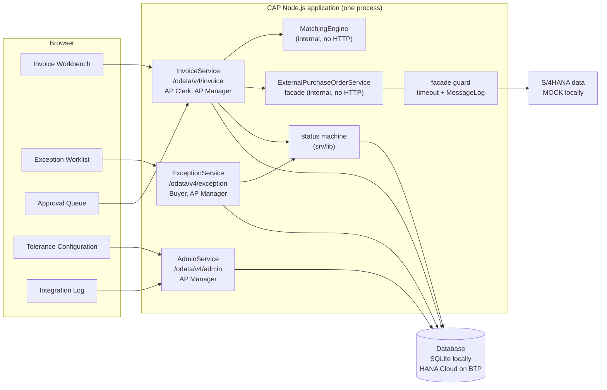
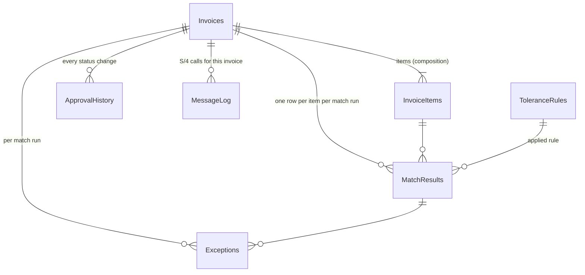
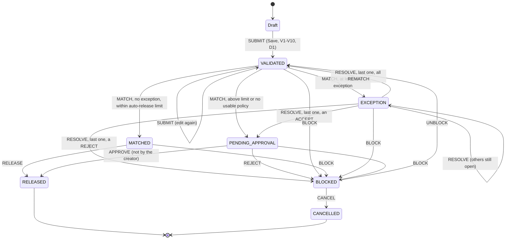
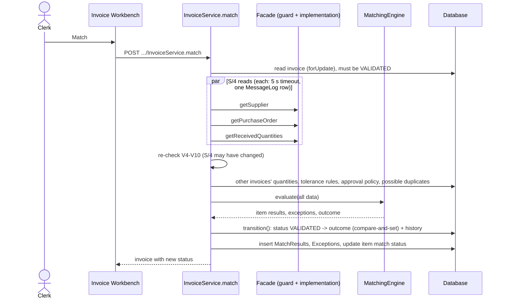
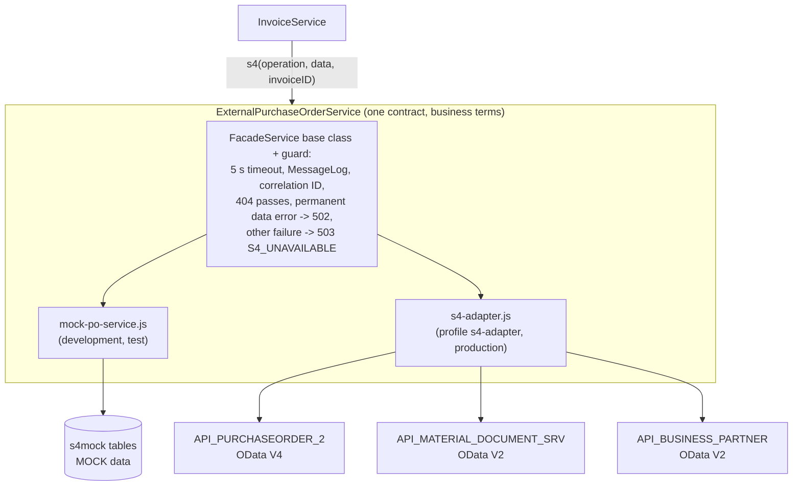
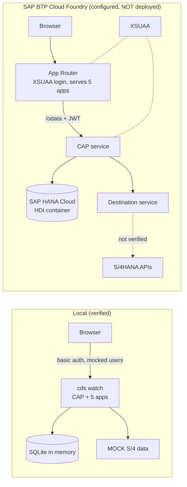

# Architecture overview

How the Invoice 3-Way Match Workbench is built. Every statement refers to code in this
repository; the reasons behind decisions are in `docs/adr/` and `docs/technical-decisions.md`.

> **Verification status.** Everything runs and is tested locally (SQLite, mocked users, MOCK
> S/4HANA data; 388 automated tests, 30 of which need the SAP API files). The SAP BTP deployment is configured and its MTA archive
> builds, but it has **not been deployed**, and **no real S/4HANA system has been called**.

## 1. The application in one picture

One CAP Node.js application (a "modular monolith", ADR 0001): one process, one database, five
CAP services, five SAP Fiori elements apps.

## 2. CAP Node.js structure

| Folder | Contents |
|---|---|
| `db/` | domain model (`schema.cds`, namespace `ap`), code lists, change-tracking annotations, seed data (`db/data`: code lists, default tolerance rules, approval policies) |
| `srv/` | service definitions (`*-service.cds`) and thin handlers (`*-service.js`) |
| `srv/lib/` | pure business logic: `matching.js`, `tolerance.js`, `decimal.js`, `duplicate.js`, `invoice-validation.js`, `status-machine.js`, `history.js`, `message-log.js`, `value-help.js` |
| `srv/external/` | the S/4 facade contract, its two implementations (mock, S/4 adapter), the guard, the place for the official SAP API definitions (`specs/`) and their imported models (`s4/`) - **not included**, see `docs/sap-api-setup.md` |
| `app/` | five Fiori elements apps (manifest + CDS annotations, no custom UI code) and a launch page |
| `mock-data/` | MOCK S/4 data: `s4mock` (facade mock) and `s4api` (SAP-shaped, for the adapter) - loaded only in development/test profiles |
| `test/` | Jest: `unit/` (pure logic), `service/` (OData requests against the running service), `integration/` (facade contract) |

Handlers stay thin: they read data, call pure functions in `srv/lib`, and write the result in
the request's transaction. The pure functions are unit-tested without a database.

## 3. CDS data model (`db/schema.cds`, namespace `ap`)

`ApprovalPolicies` has no association: the match looks up the policy by the invoice's company code.

| Entity | Purpose |
|---|---|
| `Invoices` (draft-enabled in InvoiceService) | header: supplier, supplier reference, normalised reference, PO, company code, currency, net/tax/gross, status, invoice number `INV-<year>-<6 digits>`, purchasing group, `lastMatchRunID` |
| `InvoiceItems` | PO item, quantity, unit, unit price, net amount, match status |
| `MatchResults` | insert-only snapshot per item and run: PO price/quantity, received, previously invoiced, variances, applied rules |
| `Exceptions` | PRICE_VARIANCE, QTY_VARIANCE, NO_GR, DUPLICATE_SUSPECT; responsible role, purchasing group, amount at stake, status OPEN / RESOLVED / SUPERSEDED, resolution and note |
| `ToleranceRules` | per variance type (PRICE, QUANTITY), company code or global, % and absolute limits, validity dates |
| `ApprovalPolicies` | auto-release limit per company code |
| `ApprovalHistory` | insert-only business audit trail: action, from/to status, user, role, comment |
| `MessageLog` | one row per call through the S/4 facade (see section 9) |

Amounts are `Decimal(15,2)`, quantities `Decimal(13,3)`. `Invoices` and `Exceptions` carry an
ETag (`modifiedAt`), so stale updates fail with 412.

## 4. The five services

| Service | Exposed as | Roles | What it offers |
|---|---|---|---|
| `InvoiceService` | OData V4 `/odata/v4/invoice` | APClerk, APManager | invoice drafts and Save (submission), actions `match`, `release`, `approve`, `reject`, `block`, `unblock`, `cancel`; read-only results, exceptions, history; `ApprovalQueue` projection (AP Manager); supplier/PO value helps; `checkDuplicates` |
| `ExceptionService` | OData V4 `/odata/v4/exception` | Buyer, APManager | exception worklist, `resolve` action, related invoice data restricted by purchasing group |
| `AdminService` | OData V4 `/odata/v4/admin` | APManager | tolerance rules (draft), approval policies, read-only `MessageLog` |
| `MatchingEngine` | in-process only (`@protocol: 'none'`) | - | `evaluate`: the pure matching function behind a typed contract |
| `ExternalPurchaseOrderService` | in-process only | - | the S/4 facade: `getSupplier`, `getPurchaseOrder`, `getReceivedQuantities`, `searchSuppliers`, `searchPurchaseOrders`, `listPurchaseOrderItems` |

## 5. Invoice lifecycle

All status changes after submission go through one function, `transition()` in
`srv/lib/status-machine.js`, which validates the move against the transition table, updates the
row only if it still has the expected old status, and writes the ApprovalHistory row.

**Submission** (Save of a draft, `before SAVE`): field checks from CDS annotations, then V1-V3
(amounts and items), V4-V10 (against S/4 data read through the facade), then D1 (exact duplicate,
409). Any failure keeps the draft and shows the messages on the fields.

## 6. Three-way matching

Per item, `evaluateItem()` checks (1) **price**: invoice unit price vs PO unit price
(`netPrice / priceUnit`) within the price tolerance; (2) **goods receipt**: GR-based items need a
net received quantity above zero, else NO_GR; (3) **quantity**: invoiced quantity vs open quantity
(net received, or ordered for 2-way items, minus what other invoices already claim) within the
quantity tolerance - skipped after NO_GR. Across the invoice, D3 flags a suspected duplicate
(same supplier, date and gross amount, different reference). The outcome is EXCEPTION if anything
failed, otherwise MATCHED or PENDING_APPROVAL by the company's auto-release limit.

If an S/4 call fails, the whole request rolls back: the invoice stays VALIDATED, nothing partial is
written, and the failed calls remain in the MessageLog.

## 7. SAP integration: facade, mock and adapter

- **One contract** (`srv/external/purchase-order-facade.cds`) in business terms: supplier,
  purchase order with items, received quantity per PO item. No SAP field name reaches the
  business logic.
- **Two implementations, chosen by configuration only.** `mock-po-service.js` reads hand-made
  MOCK tables. `s4-adapter.js` maps the official SAP APIs (definitions from the SAP
  Business Accelerator Hub, imported with `cds import`; not included in this repository). Both extend `FacadeService`, which installs
  the guard first; InvoiceService refuses to start with an unguarded implementation.
- **OData V2 and V4.** The Purchase Order API is OData V4, Material Document and Business Partner
  are OData V2. The adapter writes CAP queries (CQN); CAP's remote clients translate them into
  each protocol (for example `contains()` becomes V2 `substringof()`), verified against a fake SAP
  server over HTTP. Locally, CAP mocks the three SAP services in-process with SAP-shaped MOCK data
  (`mock-data/s4api`); they are never exposed over HTTP.
- **Same tests for both.** One contract test suite runs against the mock and against the adapter.

## 8. Security and role-based access

| Role | Apps | Key permissions |
|---|---|---|
| APClerk | Invoice Workbench | create, edit, submit, match, release, block |
| Buyer | Exception Worklist | read and resolve price, quantity and missing-GR exceptions of **their own purchasing group** |
| APManager | all five | everything a clerk can do except editing; approve (not their own invoices), reject, unblock, cancel; resolve all exceptions; tolerances, policies, Integration Log |

- Declared in CDS (`@requires` on services, `@restrict` on entities and actions) and enforced by
  CAP on every request, including `$filter`, `$batch`, reads by key and actions.
- **Purchasing-group isolation** is an instance restriction:
  `purchasingGroup = $user.purchasingGroup`. Associations that would let a buyer reach rows past
  the restriction via `$expand` are not exposed in ExceptionService (ADR 0005).
- **Segregation of duties** in code: `approve` refuses the invoice's creator (403 `SOD_SELF_APPROVAL`).
- Locally users are mocked (`clerk1`, `buyer1`, `manager1`, ... in `package.json`, development and
  test only). On BTP the roles are XSUAA scopes and role templates (`xs-security.json`); the Buyer
  role template carries the `purchasingGroup` attribute. A Buyer without a group sees nothing.

## 9. Audit history and integration logging

- **ApprovalHistory** - business decisions: every SUBMIT, MATCH, RESOLVE, RELEASE, APPROVE,
  REJECT, BLOCK, UNBLOCK, CANCEL with user, role, from/to status and comment. Written by the
  status machine in the same transaction as the status change; insert-only.
- **Change history** - field-level changes of invoices, exceptions and tolerance rules through
  `@cap-js/change-tracking`.
- **MatchResults** - every match run is kept (insert-only), so earlier runs remain auditable.
- **MessageLog** (Integration Log app) - one row per facade call: correlation ID (one per user
  request), operation, invoice, target system (`S4_MOCK`, `S4_CAP_MOCK` or `S4`), SUCCESS/FAILED,
  duration, sanitized error text. Never payloads, credentials or personal data. Written in its own
  transaction after the request ends, so failed calls stay logged even when the business
  transaction rolls back. Read-only, AP Manager only.

## 10. Local versus intended BTP deployment

| | Local | BTP (intended) |
|---|---|---|
| Start | `npm run watch` | `mbt build`, `cf deploy` (`mta.yaml`) |
| Users | mocked, basic auth | XSUAA (role collections) |
| Database | SQLite in memory, seeded from CSV | SAP HANA Cloud, HDI; only `db/data` (code lists, default configuration) deployed |
| S/4 data | MOCK (`s4mock`) or SAP-shaped MOCK via the adapter | the adapter through destinations `S4HANA_PURCHASEORDER_2`, `S4HANA_MATERIAL_DOCUMENT`, `S4HANA_BUSINESS_PARTNER` |
| UI | served by CAP from `app/` | served by the App Router |
| Status | **verified** (tests, browser click-through) | **built locally only**; deployment, real login, HANA persistence and S/4 connectivity unverified |
